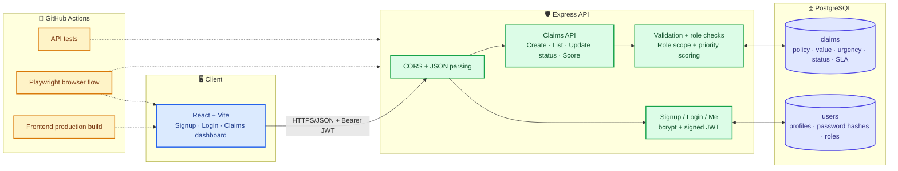
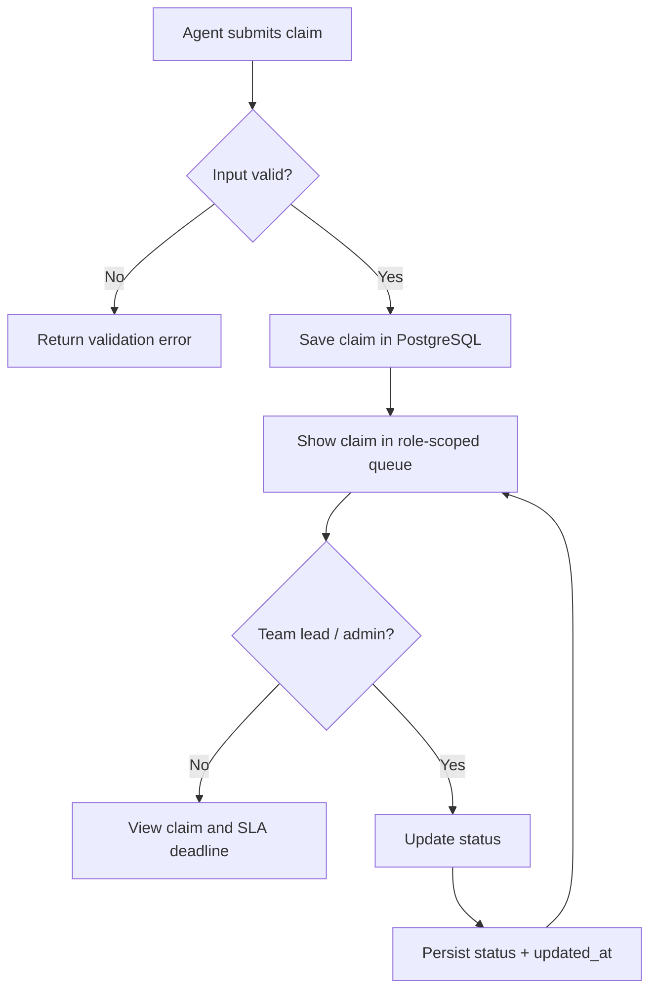

<div align="center">

# 🧾 CLAIMSYNC

### Priority-aware insurance claims management

From claim intake to triage and status updates — a role-aware workspace designed to make urgent claims visible and keep teams aligned.

<br/>

[](https://github.com/Neemasree/CLAIMSYNC/actions)
[](https://react.dev/)
[](https://nodejs.org/)
[](https://www.postgresql.org/)

</div>

---

## 🎯 Product goal

Insurance claim teams need to see what is urgent, understand who can act, and keep claim progress clear. CLAIMSYNC provides an authenticated claims workspace with validated intake, a priority-ordered queue, role-aware access, and visible SLA deadlines.

> **Current focus:** make the claim workflow real before adding automated assignment, scheduled SLA monitoring, and notification delivery.

## ✨ Current features

<table>
<tr>
<td width="50%" valign="top">

### 🔐 Authentication & access
- Account signup with bcrypt password hashing
- Email/password login with signed JWT
- Session restore and logout
- Server-side bearer-token validation
- Agent, team lead, and admin roles
- Agents see claims they created or are assigned

</td>
<td width="50%" valign="top">

### 🧾 Claims workspace
- Create claims with policyholder, policy number, type, value, urgency, description, and optional SLA deadline
- PostgreSQL persistence and validation
- Weighted priority score (0–100) combines urgency, claim value, and SLA proximity; highest score appears first
- Summary counts for total, urgent, and open claims
- Team leads/admins can update claim status
- Deadline labels: overdue, due within 24 hours, on track

</td>
</tr>
<tr>
<td width="50%" valign="top">

### 🧪 Quality checks
- Backend API tests
- React production build
- Playwright browser workflow
- Real PostgreSQL schema setup in browser CI
- Signup, login, session restore, logout and claim-intake coverage

</td>
<td width="50%" valign="top">

### 🧭 Product direction
- Automatic claim assignment and team routing
- Claim assignment and team routing
- Scheduled SLA breach detection
- Notifications and full claim audit history

These are planned extensions, not all implemented today.

</td>
</tr>
</table>

---

## 🏗️ Architecture

This diagram is kept in sync with the **implemented** application. When routes, services, data stores, or workflow responsibilities change, update both this diagram and [`docs/architecture.mmd`](docs/architecture.mmd) in the same change.



### Claim lifecycle (current implementation)



### Priority ordering

Claims are ranked using a transparent weighted score: urgency contributes 10–55 points, claim value contributes 0–20 points, and SLA proximity contributes 0–25 points. Open claims overdue on their SLA receive the strongest deadline boost. Ties are broken by earliest SLA and creation time. This is a deterministic triage heuristic, not a machine-learning model. Automatic assignment and a scheduled SLA worker are not implemented yet.

---

## 🧰 Tech stack

| Layer | Technology |
|---|---|
| Frontend | React, Vite, CSS |
| Backend | Node.js, Express |
| Database | PostgreSQL |
| Authentication | bcryptjs, HMAC-signed JWT |
| API tests | Node test runner, Supertest |
| Browser tests | Playwright + Chromium |
| CI | GitHub Actions |

---

## 🚀 Run locally

**Requirements:** Node.js 20+, npm, and PostgreSQL.

### 1. Clone the repository

```bash
git clone https://github.com/Neemasree/CLAIMSYNC.git
cd CLAIMSYNC
```

### 2. Configure PostgreSQL

Create a database named `claimsync`, then apply the schema from the repository root:

```bash
psql -d claimsync -v ON_ERROR_STOP=1 -f backend/schema.sql
```

The schema creates the `users` and `claims` tables and their indexes.

### 3. Start the API

Create `backend/.env` using `backend/.env.example`. Set `DATABASE_URL` and a strong `JWT_SECRET` (never commit real credentials).

```bash
cd backend
npm install
npm run dev
```

The API defaults to `http://localhost:5000`. Check connectivity at [`http://localhost:5000/health`](http://localhost:5000/health).

### 4. Start the frontend

In a second terminal, from the repository root:

```bash
npm install
npm run dev
```

Vite prints the local frontend URL. By default, the UI calls `http://localhost:5000`. To override it, set `VITE_API_URL` in the root `.env` before starting Vite:

```env
VITE_API_URL=http://localhost:5000
```

Do not put database credentials or private secrets in `VITE_*` variables; they are exposed to browser code.

---

## 🔌 API overview

All claim routes require a valid `Authorization: Bearer <token>` header.

| Method | Route | Purpose |
|---|---|---|
| `GET` | `/health` | API and database health check |
| `POST` | `/signup` | Register an agent account |
| `POST` | `/login` | Verify credentials and issue a JWT |
| `GET` | `/me` | Validate token and return safe user profile |
| `GET` | `/claims` | List claims within the caller's role scope |
| `POST` | `/claims` | Validate and create a claim |
| `PATCH` | `/claims/:id/status` | Update status (team leads/admins only) |

### Claim statuses

`submitted` · `in_review` · `awaiting_information` · `approved` · `rejected` · `closed`

---

## 🧪 Testing & CI

Run the backend API tests:

```bash
cd backend
npm install
npm test
```

Build the frontend from the repository root:

```bash
npm install
npm run build
```

GitHub Actions runs three jobs on pushes and pull requests to `main`:

1. **Test Express API** — API behavior and validation.
2. **Build React frontend** — production bundle.
3. **Browser end-to-end auth flow** — starts PostgreSQL, applies the schema, and exercises the browser flow with Playwright.

Check the [latest workflow result](https://github.com/Neemasree/CLAIMSYNC/actions) for the authoritative pass/fail status. A CI pass applies to the tested commit and CI environment; it does not prove that a production deployment is configured or healthy.

---

## 🗺️ Roadmap

- [x] Signup, login, and authenticated session
- [x] Role-aware claims queue
- [x] Claim intake persisted in PostgreSQL
- [x] Urgency/SLA-based ordering
- [x] Role-protected status updates
- [x] SLA deadline indicators in the dashboard
- [x] API and browser test coverage for the implemented flows
- [ ] Automated claim assignment and team routing
- [ ] Configurable weighted priority score (urgency + value + SLA proximity)
- [ ] Scheduled SLA breach detection and notification delivery
- [ ] Full claim status history and audit trail
- [ ] Production deployment and live-environment verification

## 🔒 Security notes

- Signup assigns the default `agent` role; never trust client-provided roles.
- Claim queries use parameterized SQL.
- Keep `JWT_SECRET` and `DATABASE_URL` out of source control.
- Configure production CORS origins and a strong JWT secret before deployment.
- Apply database migrations/schema updates before deploying code that depends on new tables.

---

<div align="center">

Built by **[Neema Sree K](https://github.com/Neemasree)** · [Repository](https://github.com/Neemasree/CLAIMSYNC) · [Issues](https://github.com/Neemasree/CLAIMSYNC/issues)

</div>
