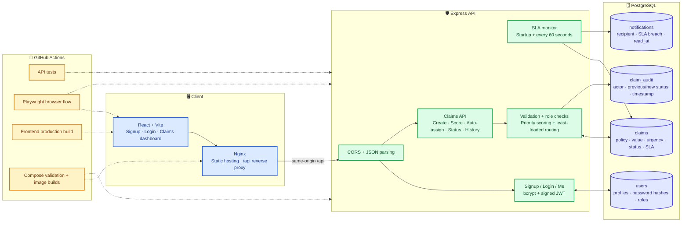
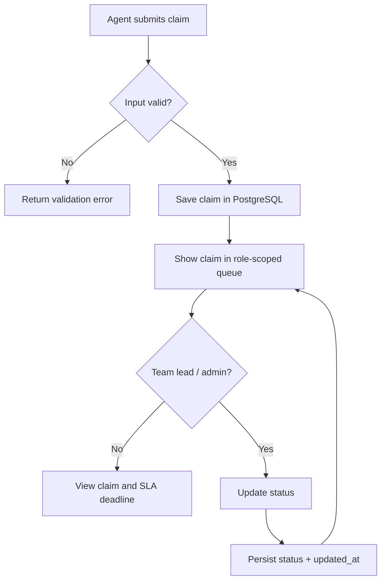

<div align="center">

# 🧾 CLAIMSYNC

### Priority-aware insurance claims management

From claim intake to triage and status updates — a role-aware workspace designed to make urgent claims visible and keep teams aligned.

<br/>

[](https://github.com/Neemasree/CLAIMSYNC/actions)
[](https://react.dev/)
[](https://nodejs.org/)
[](https://www.postgresql.org/)

</div>

---

## 🎯 Product goal

Insurance claim teams need to see what is urgent, understand who can act, and keep claim progress clear. CLAIMSYNC provides an authenticated claims workspace with validated intake, a priority-ordered queue, role-aware access, and visible SLA deadlines.

> **Current focus:** deliver traceable claim intake and status changes, role-scoped activity history, and reliable operational checks.

## ✨ Current features

<table>
<tr>
<td width="50%" valign="top">

### 🔐 Authentication & access
- Account signup with bcrypt password hashing
- Email/password login with signed JWT
- Session restore and logout
- Server-side bearer-token validation
- Agent, team lead, and admin roles
- Agents see claims they created or are assigned

</td>
<td width="50%" valign="top">

### 🧾 Claims workspace
- Create claims with policyholder, policy number, type, value, urgency, description, and optional SLA deadline
- PostgreSQL persistence and validation
- Weighted priority score (0–100) combines urgency, claim value, and SLA proximity; highest score appears first
- Searchable claims queue with status and urgency filters
- Summary counts for total, urgent, and open claims
- New claims are automatically assigned to the least-loaded agent (open-claim count, then account age)
- Deadline labels: overdue, due within 24 hours, on track
- Append-only claim creation and status-change audit trail with actor and timestamp
- Role-scoped claim history API, visible from each queue row

</td>
</tr>
<tr>
<td width="50%" valign="top">

### 🧪 Quality checks
- Backend API tests
- React production build
- Playwright browser workflow
- Real PostgreSQL schema setup in browser CI
- Signup, login, session restore, logout, claim intake, activity history, and notification panel coverage

</td>
<td width="50%" valign="top">

### 🧭 Product direction
- Configurable team routing and assignment policies
- Optional outbound email/webhook delivery for SLA alerts
- Production deployment with HTTPS, managed PostgreSQL, backups, and live-environment monitoring

SLA breach detection, durable in-app notifications, and least-loaded agent assignment are already implemented.

</td>
</tr>
</table>

---

## 🏗️ Architecture

This diagram is kept in sync with the **implemented** application. When routes, services, data stores, or workflow responsibilities change, update both this diagram and [`docs/architecture.mmd`](docs/architecture.mmd) in the same change.



### Claim lifecycle (current implementation)



### Priority ordering

Claims are ranked using a transparent weighted score: urgency contributes 10–55 points, claim value contributes 0–20 points, and SLA proximity contributes 0–25 points. Open claims overdue on their SLA receive the strongest deadline boost. Ties are broken by earliest SLA and creation time. This is a deterministic triage heuristic, not a machine-learning model. Automatic assignment now selects the least-loaded agent when an eligible agent account exists. Status changes are written to an append-only audit table and can be retrieved through the role-scoped history endpoint. A server-side monitor runs at startup and every 60 seconds. It creates one persistent in-app SLA-breach notification per assigned agent, team lead, and admin for each overdue open claim; a unique constraint prevents duplicate alerts. Users can view and mark their own notifications as read. The notification API reports the complete unread count even though the dashboard only displays the latest 50 alerts.

---

## 🧰 Tech stack

| Layer | Technology |
|---|---|
| Frontend | React, Vite, CSS |
| Backend | Node.js, Express |
| Database | PostgreSQL |
| Authentication | bcryptjs, HMAC-signed JWT |
| API tests | Node test runner, Supertest |
| Browser tests | Playwright + Chromium |
| CI | GitHub Actions |

---

## 🚀 Run locally

**Requirements:** Node.js 20+, npm, and PostgreSQL.

### 1. Clone the repository

```bash
git clone https://github.com/Neemasree/CLAIMSYNC.git
cd CLAIMSYNC
```

### 2. Configure PostgreSQL

Create a database named `claimsync`, then apply the schema from the repository root:

```bash
psql -d claimsync -v ON_ERROR_STOP=1 -f backend/schema.sql
```

The schema creates the `users`, `claims`, `claim_audit`, and `notifications` tables and their indexes. Re-running the schema is safe for these additive tables/indexes.

### 3. Start the API

Create `backend/.env` using `backend/.env.example`. Set `DATABASE_URL` and a strong `JWT_SECRET` (never commit real credentials).

```bash
cd backend
npm install
npm run dev
```

The API defaults to `http://localhost:5000`. Check connectivity at [`http://localhost:5000/health`](http://localhost:5000/health).

### 4. Start the frontend

In a second terminal, from the repository root:

```bash
npm install
npm run dev
```

Vite prints the local frontend URL. By default, the UI calls `http://localhost:5000`. To override it, set `VITE_API_URL` in the root `.env` before starting Vite:

```env
VITE_API_URL=http://localhost:5000
```

Do not put database credentials or private secrets in `VITE_*` variables; they are exposed to browser code.

---

## 🐳 Run the full stack with Docker

**Requirements:** Docker Desktop or Docker Engine with the Compose plugin.

1. Copy `.env.docker.example` to `.env`.
2. Replace both placeholder secrets. Use a long random alphanumeric database password so it can be safely embedded in the PostgreSQL connection URL, and a JWT secret of at least 32 characters.
3. Start the stack:

```bash
docker compose up --build -d
```

Open the app at [http://localhost:8080](http://localhost:8080). The API is reverse-proxied through the same origin; its health check is available at [http://localhost:8080/api/health](http://localhost:8080/api/health). PostgreSQL data persists in the `claimsync_postgres` Docker volume.

Useful commands:

```bash
docker compose ps
docker compose logs -f api
docker compose down
```

Use `docker compose down -v` only when you intentionally want to delete the local database volume and all stored claims/users. For a public deployment, configure a real HTTPS reverse proxy/domain, set `VITE_API_URL` to `/api` when the API is reverse-proxied on the same origin, and set `FRONTEND_ORIGINS` to the exact frontend origin. The included Nginx configuration already proxies `/api/*` to the internal API service. Do not expose the database port publicly.

---

## 🔌 API overview

All claim routes require a valid `Authorization: Bearer <token>` header.

| Method | Route | Purpose |
|---|---|---|
| `GET` | `/health` | API and database health check |
| `POST` | `/signup` | Register an agent account |
| `POST` | `/login` | Verify credentials and issue a JWT |
| `GET` | `/me` | Validate token and return safe user profile |
| `GET` | `/claims` | List claims within the caller's role scope |
| `POST` | `/claims` | Validate and create a claim |
| `PATCH` | `/claims/:id/status` | Update status and record audit event (team leads/admins only) |
| `GET` | `/claims/:id/history` | Read role-scoped claim activity history |\n| `GET` | `/notifications` | List the caller's latest notifications and unread count |\n| `PATCH` | `/notifications/:id/read` | Mark one owned notification as read |\n| `PATCH` | `/notifications/read-all` | Mark all caller notifications as read |

### Claim statuses

`submitted` · `in_review` · `awaiting_information` · `approved` · `rejected` · `closed`

---

## 🧪 Testing & CI

Run the backend API tests:

```bash
cd backend
npm install
npm test
```

Build the frontend from the repository root:

```bash
npm install
npm run build
```

GitHub Actions runs three jobs on pushes and pull requests to `main`:

1. **Test Express API** — API behavior and validation.
2. **Build React frontend** — production bundle.
3. **Browser end-to-end auth flow** — starts PostgreSQL, applies the schema, and exercises the browser flow with Playwright.

Check the [latest workflow result](https://github.com/Neemasree/CLAIMSYNC/actions) for the authoritative pass/fail status. A CI pass applies to the tested commit and CI environment; it does not prove that a production deployment is configured or healthy.

---

## 🗺️ Roadmap

- [x] Signup, login, and authenticated session
- [x] Role-aware claims queue with search, status, and urgency filters
- [x] Claim intake persisted in PostgreSQL
- [x] Urgency/SLA-based ordering
- [x] Role-protected status updates
- [x] SLA deadline indicators in the dashboard
- [x] API and browser test coverage for the implemented flows
- [x] Least-loaded automatic agent assignment
- [x] Weighted priority score (urgency + value + SLA proximity)
- [x] Scheduled SLA breach detection with idempotent persistent in-app notifications\n- [x] Authenticated notification list and read/unread controls
- [x] Claim status history and audit trail
- [ ] Production deployment and live-environment verification

## 🔒 Security notes

- Signup assigns the default `agent` role; never trust client-provided roles.
- Claim queries use parameterized SQL.
- Keep `JWT_SECRET` and `DATABASE_URL` out of source control.
- Configure production CORS origins and a strong JWT secret before deployment.
- Apply database migrations/schema updates before deploying code that depends on new tables.

---

<div align="center">

Built by **[Neema Sree K](https://github.com/Neemasree)** · [Repository](https://github.com/Neemasree/CLAIMSYNC) · [Issues](https://github.com/Neemasree/CLAIMSYNC/issues)

</div>
